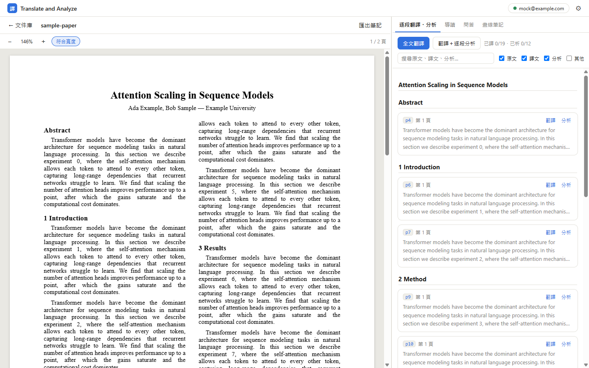
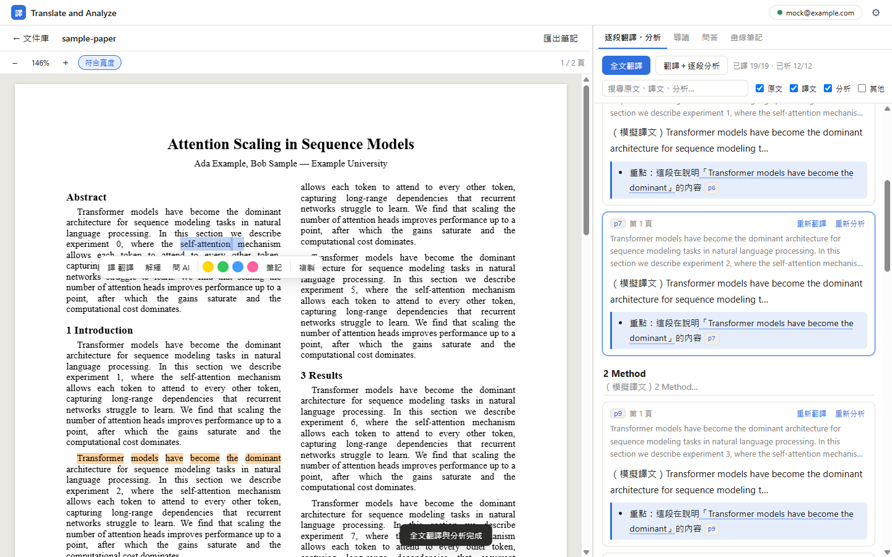
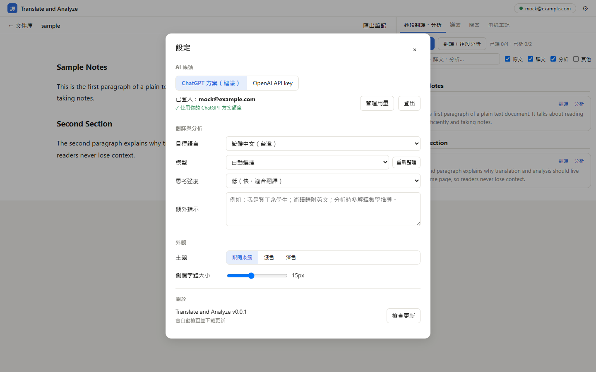

# Translate and Analyze

讀論文的好幫手：打開 PDF 或 TXT，**翻譯、畫線、逐段分析都在同一個畫面**。分析會直接引用原文，點一下就跳回原文對應的位置。AI 使用你自己的 **ChatGPT 方案（Plus / Pro）**，不需要 API key，也不會另外收費。



## 下載與安裝（Windows）

1. 打開 **[最新版下載頁](https://github.com/teddylu0219/translate-and-analyze/releases/latest)**，在下面的「Assets」點 **`TranslateAnalyze-Setup-x.y.z.exe`** 下載。
2. 雙擊下載好的檔案。
   - 如果跳出藍色視窗「**Windows 已保護您的電腦**」：點 **其他資訊** → **仍要執行**。（這是因為程式沒有購買付費的程式碼簽章，不是病毒。）
3. 安裝會自動完成並開啟程式，桌面上也會出現「Translate and Analyze」捷徑。

**更新**：程式會自動在背景下載新版本。下載好後，畫面上方會出現「立即重新啟動更新」，按下去就好；不按的話，下次關閉程式時也會自動更新。

## 第一次使用：連接 ChatGPT

1. 按右上角的 **Continue with ChatGPT**（或齒輪 ⚙ → 設定）。
2. 瀏覽器會打開 ChatGPT 登入頁。登入後，按 **允許／Allow**，同意這個 app 使用你的方案額度。
3. 看到「登入完成」就可以關掉瀏覽器分頁，回到程式。

> 需要 ChatGPT Plus、Pro 或其他支援的方案。用量會算在你的 ChatGPT 方案裡，可以到 [ChatGPT 設定 → Usage](https://chatgpt.com/settings/usage) 查看，也可以替這個 app 設定上限。

## 怎麼用

| 想做的事 | 怎麼做 |
|---|---|
| 開啟檔案 | 把 PDF / TXT 拖進視窗，或按「＋ 開啟 PDF / TXT」。開過的檔案會留在「我的文件」。 |
| 整篇翻譯 | 右側「逐段翻譯・分析」→ **全文翻譯**。譯文會一段一段出現。 |
| 翻譯＋逐段分析 | 按 **翻譯＋逐段分析**。每段會有重點分析，並用「」引用原文。 |
| 從分析跳回原文 | 點分析裡**有底線的引用**，或點段落編號（例如 `p12`），左邊原文會捲過去並閃一下。 |
| 從原文找到譯文 | 在左邊原文點一下某段，右邊會自動捲到那段的譯文。 |
| 翻譯某幾個字 | 在原文選取文字 → 浮動選單按 **翻譯**。 |
| 畫線、寫筆記 | 選取文字 → 點顏色圓點畫線，或按 **筆記**。所有畫線都在「畫線筆記」分頁。點已畫的線可以改顏色或刪除。 |
| 問 AI | 選取文字 → **解釋** 或 **問 AI**；也可以到「問答」分頁直接問。回答會引用原文和段落編號。 |
| 整篇導讀 | 「導讀」分頁 → **產生全文導讀**：一句話總結、方法、結果、貢獻、限制、建議閱讀順序。 |
| 匯出 | 上方 **匯出筆記**，會把導讀、畫線、筆記、譯文存成 Markdown 檔。 |
| 縮放 | 工具列的 − / ＋，或按住 Ctrl 滾動滑鼠滾輪。 |



**設定**（右上角 ⚙）：目標語言（預設繁體中文）、模型、思考強度、給 AI 的額外指示（例如「我是資工系學生，術語附英文」）、淺色／深色主題、側欄字體大小。



## 常見問題

- **掃描的 PDF 沒有文字？** 掃描檔是圖片，需要先用 OCR（例如 Adobe Acrobat 或線上 OCR 工具）轉成可選取文字的 PDF。
- **出現「已達使用上限」？** 你的 ChatGPT 方案額度或為這個 app 設的上限用完了，按「Manage usage」查看重置時間。
- **登入卡住？** 在設定裡按「取消」再重試。如果有開著 Codex 等其他工具，先關掉它們（它們會占用登入用的連接埠）。
- **資料存在哪裡？** 都只存在這台電腦（`%APPDATA%\Translate and Analyze`），登入憑證以 Windows 加密保存。

---

## 開發者

需要 Node.js 24 以上。

```bash
npm install
npm run dev
```

- `npm run typecheck`：型別檢查
- `npm run build && npm run e2e`：用模擬 AI（不打 OpenAI）跑一次完整的端對端測試，截圖存在 `e2e/out/`
- `npm run dist`：在本機產生安裝檔到 `dist/`
- **發新版**：改 `package.json` 的 `version`，commit 後推一個同版本的 tag（例如 `git tag v0.2.0 && git push --tags`），GitHub Actions 會在 Windows 上建置並發到 Releases，已安裝的使用者會自動更新。

架構：Electron + Vite + React + TypeScript。PDF 顯示用 pdf.js；AI 走 OpenAI Responses API，登入採用 [Sign in with ChatGPT（開源／本機 app 流程）](https://developers.openai.com/siwc/token-sharing-open-source)，在 `127.0.0.1:1455` 接收 OAuth 回呼。

| 位置 | 內容 |
|---|---|
| `src/main/auth.ts` | ChatGPT OAuth（PKCE、註冊、token 更新、登出撤銷） |
| `src/main/ai.ts` | Responses API 串流與錯誤處理 |
| `src/main/library.ts` | 文件庫與每份文件的資料 |
| `src/renderer/src/lib/paragraphs.ts` | 從 PDF 文字層抽出段落、對回引用原文 |
| `src/renderer/src/lib/prompts.ts` | 翻譯、分析、導讀、問答的提示詞 |
| `src/renderer/src/components/` | 閱讀器、側欄各分頁、設定 |

## 授權

MIT
